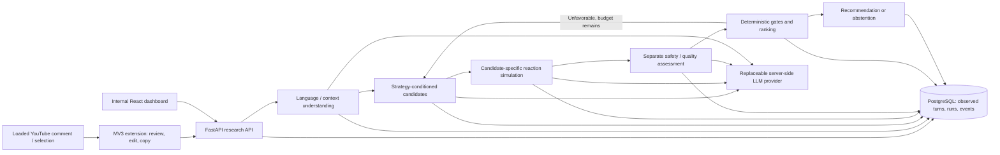

# Architecture and contracts

## Scope and evidence boundary

This documentation precedes the first code milestone. The supplied repository is already a new, documents-only project. Add original implementation here on `feat/greenfield-research-engine`; do not access or import the historical repository. Existing handoff wording requiring first-milestone approval is superseded by the user's explicit instruction to begin implementation now.



The extension never posts, stores provider secrets, or interprets a simulated reaction as an observed reply. The dashboard reads stored events; it does not simulate inference in the browser. The two frontends are later milestones and are not fabricated in milestone 1.

## Backend modules

`schemas.py`: strict external/model-output contracts, language/strategy/mode enums, observed turns, reaction distributions, independent assessment, candidates, events, run view. Pydantic forbids unknown output fields (including hidden reasoning), rejects nonfinite/out-of-range scores and malformed distributions.

`providers/base.py`: asynchronous JSON completion protocol returning validated payload plus provider/model, usage and latency. `providers/openai_compatible.py`: server-only HTTP provider, separate trusted system message and JSON-encoded untrusted conversation data, bounded retries for transient failures, timeout, response validation. No offline generator or canned fallback in production. An absent configuration yields an explicit 503.

`prompts.py`: versioned stage contracts, language/script instructions, evidence-only factual corrections, concise auditable decision summaries (no hidden reasoning). Analysis, generation, simulation, and assessment are separate calls. The same underlying LLM may serve all stages initially, so assessment is **procedurally separate but not an independently validated judge**.

`output_script.py`: deterministic Unicode gate, independent of language detection/assessment. Resolve the required script from the language override/resolved language, requested script and current input (never prior history). Validate every generated/refined candidate before simulation/assessment. Allow Latin English within native Hindi/Malayalam, require actual native letters for native requests, and reject any non-Latin linguistic characters for Romanized requests. Preserve the exact original candidate; store versioned checks/reasons/code points. Reuse only the existing refinement budget, with null model scores/assessments for rejected text. Apply the same script gate to the one-call baseline without adding model assessment or refinement. Historical records without this optional field remain readable; absence is not a retroactive pass.

`policy.py`: deterministic score and hard gates. Defaults are engineering hypotheses, not research findings. Eligible candidate: safety approved, toxicity ≤ 0.20, relevance ≥ 0.50, output-language match approved. Full mode also requires estimated escalation ≤ 0.25 and de-escalation ≥ 0.55. Rank by weighted simulated de-escalation (0.45), relevance (0.15), argument strength (0.15), inverse toxicity (0.15), language quality (0.10). No-simulation mode renormalizes remaining weights. Keep every candidate, acceptance/rejection reason, tie-break order and threshold in the trace. Abstain if no candidate clears gates after the configured refinement bound.

`pipeline.py`: use observed recent history and model-assessed hostility trend as prompt context; log the current hostility delta; analyse current message; generate N strategies; simulate and separately assess each; rank; pass candidate-specific feedback into a bounded new round; select or abstain. Model-reported numbers are **uncalibrated model estimates**. Persist validated stage events immediately. Successful candidates remain inspectable even if a later call fails. A provider failure fails the run rather than claiming a recommendation.

`store.py`: SQLAlchemy over PostgreSQL in deployment, SQLite for development. Conversations contain only submitted real turns (source `user_provided_observation`). A generated recommendation is not a posted reply. Runs have states `running/completed/abstained/failed`, config snapshot, prompt version, provider metadata and final result. Events have a monotonic sequence, UTC timestamp, stage and typed public payload. DB-backed per-conversation active-run claim prevents concurrent history reordering across API workers. Failure clears the claim; crash recovery explicitly fails orphaned running jobs after a timeout. Foreign keys and transactions preserve referential integrity.

`api.py`: authenticated local research API, exact-origin CORS, bounded request size and input lengths; FastAPI lifespan initializes DB and closes HTTP client. Synchronous completion endpoint for milestone 1; later add a job worker + 202 enqueue and polling/SSE for long live demos. Reads can retrieve persisted events during execution. Do not expose on a public network without a real identity/access system and retention policy.

## API (version `/v1`, generated OpenAPI at `/docs`)

All research routes require `X-API-Key` matching server `RESEARCH_API_KEY`; health exposes no data. API key is a local research access token, **not** the provider key. Later extension options may store only this access token and backend URL, scoped to the user's research server.

| Method / route | Input | Output / behavior |
|---|---|---|
| GET `/health` | none | liveness + whether inference is configured; no model claims |
| GET `/v1/capabilities` | none | languages, modes, estimates disclosure, max rounds |
| POST `/v1/conversations` | optional title | new conversation ID |
| GET `/v1/conversations/{id}` | UUID | observed turns, runs and measured hostility trend |
| POST `/v1/conversations/{id}/turns` | speaker + actual observed text | append a real human-posted reply/message; never append simulations |
| POST `/v1/runs` | text, optional conversation ID, initial observed context, output language/script override, candidate count, refinement limit, experiment mode | run ID, conversation ID, final candidate or abstention, full run view; 409 for busy conversation; 502 for failed provider run with run ID |
| GET `/v1/runs/{id}` | UUID | exact persisted run, result, candidates and complete event trace |
| GET `/v1/runs` | bounded limit | recent run summaries for dashboard |

IDs and foreign references are server-generated UUIDs. Invalid IDs/payloads → 422; unknown resource → 404; unauthorized → 401; missing provider → 503; transient or invalid provider output → 502 with sanitized code and trace ID. Model/error raw text and credentials must not be returned by failure handlers.

## Data model

`conversations(id, title, created_at, active_run_id)` → `turns(id, conversation_id, sequence, speaker, text, provenance, created_at)` and `runs(id, conversation_id, status, created_at, updated_at, request_json, result_json, error_code)`. `trace_events(id, run_id, sequence, stage, payload_json, created_at)` records each completed model call, ranking, refinement and terminal decision. Candidate/simulation/assessment structures live in versioned JSON initially; avoid premature tables for experimental dimensions. A schema migration is the deployment authority; `create_all` is only for local/test startup. Keep all history; cap model context explicitly, and log the count/IDs included. Later add retention/deletion, dedicated user identities, paged traces and background workers.

## Experiment and evaluation boundary

`full`: generation + candidate simulation + assessment + refinement + observed history. `no_history`: same without earlier conversation context/trend. `no_simulation`: generate and assess once, quality-rank without reaction metrics. `single_shot`: one generation call for one response; no reaction/refinement or previous history, clearly `unevaluated` and requiring human review. Initial input context remains the same only where the preregistered comparison permits it; baseline defaults to current comment alone.

Independent evaluation is a separate data collection step: store dataset source, license status, source thread, split group, language/script, model/config, mode and run ID. Export blinded responses without strategy/simulation/model labels; accept real ratings only with explicit provenance. Do not report quality/cost/accuracy when a metric/model price or independent labels are absent. Proposal's 100–150 examples are a study target, not completed work.

## Deployment and repository layout

```text
backend/
  pyproject.toml, requirements.lock, Dockerfile
  alembic.ini, migrations/
  src/counterspeech/{api,config,schemas,store,pipeline,policy,prompts}.py
  src/counterspeech/providers/{base,openai_compatible}.py
  tests/                    # new test-only deterministic provider fixtures
configs/experiments/        # full and ablation JSON configs
docs/engineering/          # requirements, architecture, milestones, evaluation
docs/PROJ_2.pdf             # original, unchanged
dashboard/                 # later: React client of /v1/runs and conversations
extension/                 # later: MV3 YouTube adapter and popup
compose.yaml               # API + PostgreSQL; frontends added later
.github/workflows/ci.yml
PROJECT_STATUS.md
```

Docker deployment uses PostgreSQL, migrations before API startup, health checks, non-root API process and external environment credentials. No production secrets in image, repository, trace or frontend. Run the provider on a controlled server; never send user text to a third party without the demo user's informed choice. HTTP tests use local mock transport, not external model calls.
